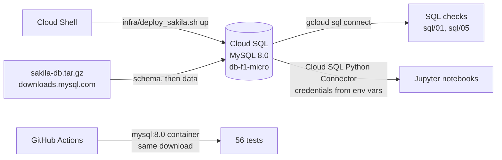

# Sakila on Google Cloud SQL (MySQL 8.0)

[](https://github.com/ajace13/sakila-cloudsql-mysql/actions/workflows/ci.yml)

I stood up a managed MySQL 8.0 database on Google Cloud SQL from the command line and loaded the Sakila DVD-rental sample database. Then I queried it from Python and answered 34 SQL questions, each one checked against the data. I also used an AI assistant to write the deploy script and read query plans, and recorded every place it was wrong and how I caught it.

**Highlights**

- **One re-runnable deploy script** ([infra/deploy_sakila.sh](infra/deploy_sakila.sh)). It creates the instance and database only if they're missing, imports only into an empty schema, prints three verification numbers, and tears everything down behind a typed confirmation. No password is ever written to a file.
- **The load is reconciled, not assumed.** The course material quoted 16,049 payments totalling 67,416.51, but the current Sakila 1.5 download has 16,044 payments totalling 67,406.56. I report what the database returns and explain the gap, instead of "fixing" the data to match a remembered number.
- **34 SQL questions, with the traps called out.** One film rents for 6 days, not 7. "Not empty" has to exclude both `NULL` and `''`. Two different actors share a name. Ties at a `LIMIT` need a tie-breaker. Two questions correctly return nothing.
- **A modeling change written as a migration.** The `payment_type` lookup table with a foreign key from `payment` can run twice safely and comes with a rollback script. Tests confirm it leaves every payment unchanged.
- **AI output checked against the database.** For each claim the assistant made about keys, plans or facts, I named the `DESCRIBE` or `EXPLAIN` column that confirms or contradicts it.
- **56 automated tests** run in CI against a fresh MySQL 8.0 container loaded with Sakila. They cover every query result, the reconciliation checks, the migration and the shell scripts.

## How it fits together



## Run it

**On Google Cloud** (needs a project with billing; `db-f1-micro` is the smallest tier, but it bills for as long as it runs, so tear it down when you're done):

```bash
git clone https://github.com/ajace13/sakila-cloudsql-mysql.git && cd sakila-cloudsql-mysql
cp infra/env.example.sh infra/env.sh && nano infra/env.sh   # project id, region, instance name
./infra/deploy_sakila.sh up      # asks for a root password with a hidden prompt; safe to re-run
./infra/deploy_sakila.sh down    # deletes the instance after you type 'delete'
```

Running it against an instance that already exists prints `Instance already exists; skipping create`, skips the import and prints the counts:

```
Verification (compare with the known values in CLAUDE.md):
  base tables:   16
  films:         1000
  payment total: 67406.56
```

The full manual walkthrough, with troubleshooting, is in [docs/runbook.md](docs/runbook.md).

**Locally, without a cloud account.** Load Sakila into any MySQL 8.0 and point the tests at it:

```bash
curl -LO https://downloads.mysql.com/docs/sakila-db.tar.gz && tar -xzf sakila-db.tar.gz
mysql -uroot -p < sakila-db/sakila-schema.sql && mysql -uroot -p < sakila-db/sakila-data.sql
pip install pymysql pytest
MYSQL_PASSWORD=... pytest -q
```

## The SQL

| File | What it does |
|---|---|
| [sql/01_verify_load.sql](sql/01_verify_load.sql) | base tables, films, payment count and total; row counts for all 16 tables |
| [sql/02_sakila_questions.sql](sql/02_sakila_questions.sql) | 34 questions, one query each, schema-qualified, with notes where a question is ambiguous |
| [sql/03_top_customers_by_store_city.sql](sql/03_top_customers_by_store_city.sql) | top 5 customers by total paid with their store's city, plus two reconciliation checks |
| [sql/04_explain_plans.sql](sql/04_explain_plans.sql) | `EXPLAIN` for a filter, an aggregate and a five-table join |
| [sql/05_fact_checks.sql](sql/05_fact_checks.sql) | one query per fact the AI assistant stated, and an independent check of a query it wrote |
| [sql/06_payment_type.sql](sql/06_payment_type.sql) | the `payment_type` lookup table and foreign key, re-runnable; [rollback](sql/06_payment_type_rollback.sql) |

### Top 5 customers by total payments, with their store's city

| customer_id | name | store | store city | payments | total paid |
|---:|---|---:|---|---:|---:|
| 526 | KARL SEAL | 2 | Woodridge | 45 | 221.55 |
| 148 | ELEANOR HUNT | 1 | Lethbridge | 46 | 216.54 |
| 144 | CLARA SHAW | 1 | Lethbridge | 42 | 195.58 |
| 137 | RHONDA KENNEDY | 2 | Woodridge | 39 | 194.61 |
| 178 | MARION SNYDER | 2 | Woodridge | 39 | 194.61 |

The city comes from the customer's *store* (customer → store → address → city), not from where the customer lives. Payments are summed per customer before the store joins, so those joins can't repeat payment rows. Two checks back this up. The first sums the per-customer totals over all 599 customers and gets 67,406.56, the same as `SUM(amount)` on `payment`. The second sends the same total through the store, address and city joins, and it still comes to 67,406.56.

### Where the questions hide a trap

| Question | The trap | What the query does |
|---|---|---|
| Q5: cost to rent ACADEMY DINOSAUR for two weeks | `rental_rate` covers `rental_duration` days, and this film's duration is 6, not 7 | 0.99 × 14 / 6 = **2.31** |
| Q6: unique districts of customers, staff and stores | no district is `NULL`, but three are `''` | excludes both; `UNION` removes duplicates |
| Q12: total spent in 2005 | 182 payments are dated February 2006 | half-open date range: **66,892.38** |
| Q20 and Q22: "top 2" | ten R-rated films tie at 29.99; four films tie at 185 minutes | `title` breaks the tie so the answer is repeatable |
| Q24: actors in more than 25 films | two different actors are both named SUSAN DAVIS | groups by `actor_id`, not by name |
| Q25: actors in German-language films | German exists in `language`, but every film is English | correctly **empty** |
| Q26: customers with more than 3 Horror rentals | rentals or distinct films? | counts rentals (34 customers); distinct films would give 32 |
| Q29: addresses where `address2` has text | 4 are `NULL` and 599 are `''` | `IS NOT NULL` alone would return 599 blank rows; correctly **empty** |

## Working with an AI assistant, and checking it

I used Claude Code and Claude Cowork under standing rules ([agent/CLAUDE.md](agent/CLAUDE.md)). The rules were: read the command log first, show the plan and the diff before anything runs, never see a password or project ID, and verify with a number, not with "it ran". The full logs are in [docs/](docs/). The main places it was wrong:

- **The deploy script's first draft** had a duplicated block and an unmatched `fi`. It would also have re-imported the schema over existing data for any table count other than 16, and it treated a failed cloud lookup as "resource missing". I asked for revisions before approving anything. The final script imports only into a confirmed-empty schema and stops on any failed lookup.
- **The data dictionary** was too confident that film categories overlap: the schema allows it, but that doesn't prove the data has it. It also suggested that pre-aggregating before a join prevents double counting, which it doesn't. I checked both claims against the `CREATE TABLE` statements and had them corrected ([docs/data_dictionary.md](docs/data_dictionary.md)).
- **Reading query plans** ([docs/query_plans.md](docs/query_plans.md)), it said "about 1,200 rental lookups" when the plan means about 400 lookups returning about 1,200 rows. It also called `eq_ref` "the best join type" and stated how `filtered` is calculated without evidence. I caught these by asking which `EXPLAIN` column supports each statement.
- **Proposing an index** for a full scan, it suggested an index on `film(rating)`. Judged from the plan's `rows` column (1,000, with the filter naming every rating), it would barely help, so I didn't create it.

## Repository layout

```
infra/       deploy_sakila.sh (up/down), env.example.sh, start_jupyter.sh, command_log.sh (every command I ran)
sql/         the queries and the payment_type migration
notebooks/   01: connect from Python and query; 02: the 34 questions and the AI checks (executed on Cloud SQL)
docs/        runbook, data dictionary, query plans, payment_type model, AI logs
agent/       the standing rules the AI assistant worked under
tests/       56 tests: query results, reconciliation, migration, shell scripts
```

## Credits

Built for ADSP 31011 Cloud-Native Data Engineering at the University of Chicago, Autumn 2026. The Sakila sample database is © Oracle Corporation, distributed under the New BSD license, and is downloaded at run time rather than stored here. My own code is MIT licensed (see [LICENSE](LICENSE)).
