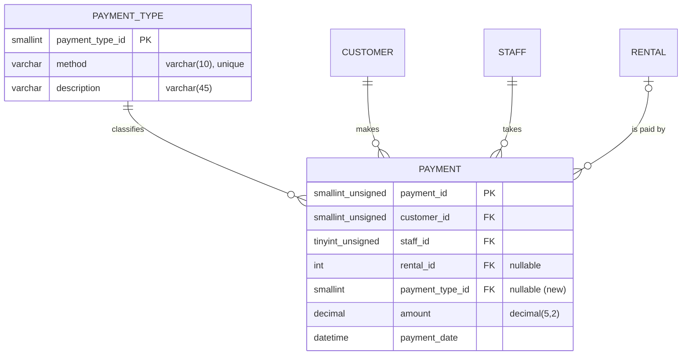

# Modeling change: a `payment_type` lookup table

The design task was to add a lookup table `payment_type` with a one-to-many relationship to `payment`. I first did it in MySQL Workbench, by reverse-engineering the loaded database into an EER model and adding the table there. `sql/06_payment_type.sql` is the same change written as a migration you can re-run, and `tests/test_payment_type.py` applies it, checks it, and rolls it back.

## The relationship

## The `payment` table, field by field

Checked against `SHOW CREATE TABLE sakila.payment` and `information_schema.key_column_usage` on a fresh load, with the migration applied.

| Field | Primary key | Foreign key | Related table and cardinality |
|---|---|---|---|
| `payment_id` | Y | N | none. Surrogate key, `AUTO_INCREMENT` |
| `customer_id` | N | Y | `customer.customer_id`: many payments to one customer (each customer has 12 to 46 payments in this data) |
| `staff_id` | N | Y | `staff.staff_id`: many payments to one staff member |
| `rental_id` | N | Y | `rental.rental_id`: zero or one rental per payment. The column is nullable and `ON DELETE SET NULL`. The schema allows several payments per rental, but this data has exactly one (16,044 distinct rentals for 16,044 payments) |
| `payment_type_id` *(new)* | N | Y | `payment_type.payment_type_id`: many payments to one payment type. Nullable, because existing payments never recorded a method |
| `amount` | N | N | none |
| `payment_date` | N | N | none |
| `last_update` | N | N | none |

## Choices in the migration

- **Nullable foreign key.** Sakila never recorded how anyone paid, so the 16,044 existing payments get `NULL` rather than an invented default. The check at the end of the script shows the payment count and total unchanged (16,044 and 67,406.56).
- **`ON DELETE RESTRICT`.** A payment type that is still in use can't be deleted. This matches how Sakila treats `customer` and `staff`.
- **`method` is unique.** That stops two rows from both meaning "card".
- **Re-runnable.** MySQL 8.0 has no `ADD COLUMN IF NOT EXISTS`, so each step checks `information_schema` before running. A second run changes nothing.
- **Integer width.** The original design says `SMALLINT(6)`. MySQL 8.0 ignores integer display widths, so the script writes `SMALLINT`, with the same range and storage.
